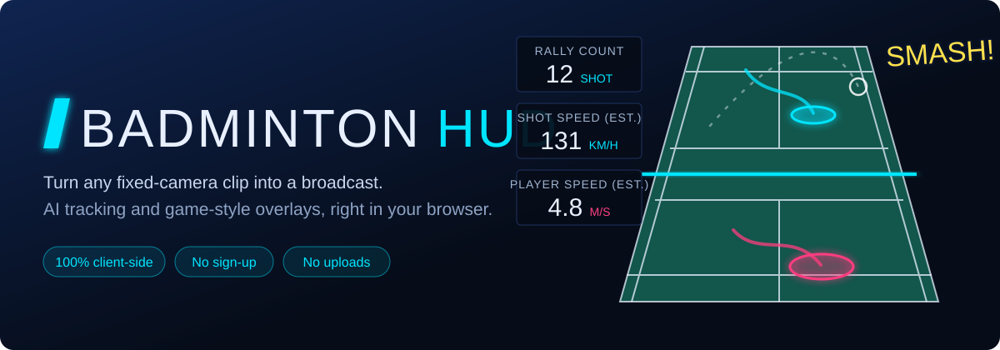
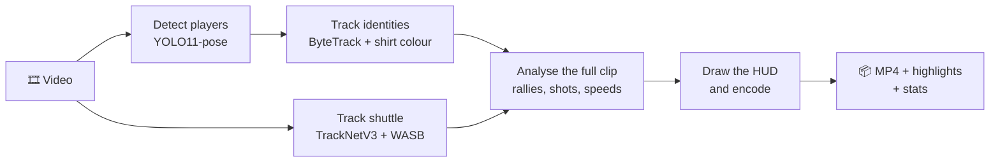

<div align="center">



### Your badminton clip, with a TV broadcast's graphics.

Drop in a video. AI tracks every player and the shuttle, then renders an MP4 with name tags, speeds, a live court map and highlight reels.
**It all runs in your browser, so your footage never leaves your computer.**

<br>

[**▶ Try it now**](https://gob123th.github.io/Badminton-Generate-HUD/) &nbsp;·&nbsp; [Features](#-features) &nbsp;·&nbsp; [How it works](#-how-it-works) &nbsp;·&nbsp; [Run locally](#-run-locally)

<br>


<br>

[](https://buymeacoffee.com/gob123th)

</div>

---

## ✨ Features

| | |
|---|---|
| 🎯 **Player tracking** | Singles and doubles. Partners on the same side are told apart by shirt colour, and far-side players get a zoomed detection pass. |
| 🏸 **Shuttle tracking** | Two neural networks follow the shuttle, while filters reject shuttles from neighbouring courts. |
| 📊 **Player stats** | Live speed, top speed, distance per rally and in total, plus a position heatmap for each player. |
| 💥 **Shot analysis** | Shot count, rally timer, estimated shot speed with game-style ranks from C to SSS, and an optional **SMASH!** call. |
| 🎬 **Highlight reel** | The best rallies, cut together automatically into a second video. |
| 🎨 **Make it yours** | 5 themes, 3 panel styles, and panels you can drag and resize. Export over the video, as 16:9, or as 9:16 for Reels and TikTok. |
| 🧾 **Your data** | Download `stats.json`, per-frame JSONL and a heatmap PNG. Your MP4 keeps its original audio. |

## 🚀 Four steps

1. **Drop in a video** and choose the part you want. Use *Test 15 s* for a quick first try.
2. **Click the 4 court corners**, in any order, so the image maps to real distances on the floor.
3. **Name the players.** They are detected and cropped for you, so just add names, colours and teams.
4. **Style it and render.** Choose a theme, arrange the HUD, then keep the tab open while it works.

> **Works best with:** a fixed camera, visible court lines, and the latest Chrome or Edge on a desktop or laptop.

## 🔒 Private by design

There is no backend. Your video is decoded, analysed and encoded on your own machine with WebGPU and WebCodecs, and it is never uploaded.

| Data | Where it goes |
|---|---|
| Your video and rendered output | Stays on your computer |
| Settings, player names, player thumbnails, court corners | This browser's `localStorage`, with a one-click delete on the [privacy page](https://gob123th.github.io/Badminton-Generate-HUD/#/privacy) |
| Page-view statistics | [Umami](https://umami.is), which does not use cookies according to its documentation |
| Normal web requests for the page and libraries | GitHub Pages and jsDelivr |

## 🧠 How it works



The video is read twice. The first pass analyses every frame. The second draws the HUD with knowledge of the whole trajectory, which is how a speed can appear the moment a shot is hit.

**Built with:** [ONNX Runtime Web](https://onnxruntime.ai/) for inference, [Mediabunny](https://mediabunny.dev/) for video I/O, and plain ES modules with no framework and no bundler.

## 🎯 How accurate is it?

Good enough to enjoy, but not officiating-grade. Anything shown as a measurement is labelled **EST.** for a reason:

- **Speeds and distances are estimates** from one camera. Shot speed comes from the distance between hitter and receiver and the flight time, corrected for air drag.
- **Stamina is a game-style value**, not a physical measurement.
- **The SMASH! call is an experimental guess** from the shuttle's path and hasn't been validated against known smashes yet. You can switch it off or raise its speed threshold.
- **Point counting is off by default** because it is still often wrong, and teams changing ends between games isn't handled yet.
- **Casual footage is harder.** Oblique angles, doubles and neighbouring courts cause more missed or misattributed shots than a clean broadcast view.

## ⏱️ Performance

Every frame passes through several AI models on your own hardware. As a reference, a **35-second 720p clip took about 2.5 minutes** on a Mac with WebGPU. To go faster, detect every 2–5 frames, use the lighter YOLO11n model, or turn off shuttle tracking.

| Browser | Status |
|---|---|
| Chrome / Edge on desktop | ✅ Recommended |
| Without WebGPU | ⚠️ Falls back to CPU and runs much slower |
| Android | ⚠️ Untested; some phones may lack WebGPU or enough memory |
| Safari, or any browser on iPhone/iPad | ❌ Not supported |

## 💻 Run locally

No install or build step. You only need any static file server:

```bash
git clone https://github.com/gob123th/Badminton-Generate-HUD.git
cd Badminton-Generate-HUD
python3 -m http.server 8080
```

Then open <http://localhost:8080> in Chrome or Edge. Opening `index.html` directly from `file://` won't work. To deploy, upload the folder to any static host, such as GitHub Pages, Netlify or Cloudflare Pages.

<details>
<summary><b>Project structure</b></summary>

```
index.html       UI shell, pages and pinned CDN imports
js/pipeline.js   Two-pass pipeline: analyse → render + encode
js/detector.js   YOLO11-pose via ONNX Runtime Web
js/bytetrack.js  ByteTrack multi-object tracking
js/players.js    Track → named player (court side, shirt colour)
js/shuttle.js    TrackNetV3 and WASB shuttle tracking
js/rally.js      Pure analysis: hits, speeds, rallies, scoring
js/stats.js      Distance, player speed, heatmap data
js/hud.js        All HUD drawing on canvas
js/layout.js     Drag-and-resize HUD editor
js/court.js      Court model and homography
js/report.js     Post-render table and heatmaps
models/          ONNX models
fonts/           Kanit, Bebas Neue
```
</details>

## 🙏 Credits

| Project | Used for | License |
|---|---|---|
| [Ultralytics YOLO11](https://github.com/ultralytics/ultralytics) | Pose detection | AGPL-3.0 |
| [TrackNetV3](https://github.com/qaz812345/TrackNetV3) | Shuttle tracking | MIT |
| [WASB-SBDT](https://github.com/nttcom/WASB-SBDT) | Assist shuttle tracking | MIT |
| [ONNX Runtime Web](https://github.com/microsoft/onnxruntime) | In-browser inference | MIT |
| [Mediabunny](https://github.com/Vanilagy/mediabunny) | Video decoding and encoding | MPL-2.0 |
| [Kanit](https://fonts.google.com/specimen/Kanit), [Bebas Neue](https://fonts.google.com/specimen/Bebas+Neue) | Typography | SIL OFL |

The player-stats and heatmap ideas were inspired by [Good-Badminton](https://github.com/yo-WASSUP/Good-Badminton) (Apache-2.0).

<div align="center">
<br>

**[▶ Make your first video](https://gob123th.github.io/Badminton-Generate-HUD/)**

Enjoying Badminton HUD? A coffee helps keep it going.

[](https://buymeacoffee.com/gob123th)

</div>
